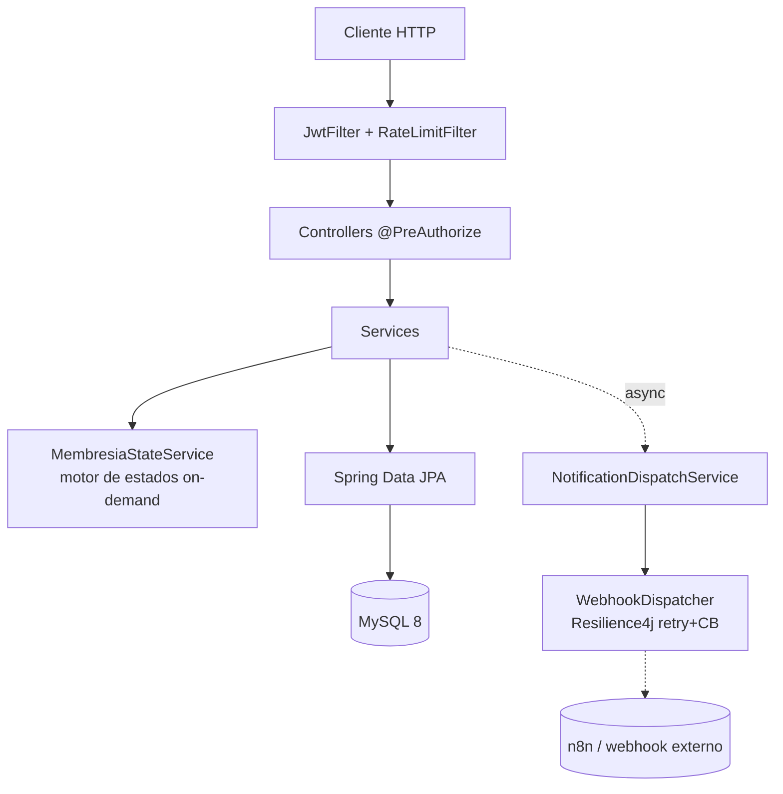

# ClubCore

API REST para la gestión integral de un instituto de salud / complejo deportivo: membresías con motor de estados, pagos, reservas de turnos, rutinas personalizadas, control de accesos e integraciones webhook asíncronas.

[](https://api.clubcore.mateopavoni.com.ar/swagger-ui.html)


**Demo en vivo**: [api.clubcore.mateopavoni.com.ar/swagger-ui.html](https://api.clubcore.mateopavoni.com.ar/swagger-ui.html) — Swagger interactivo contra la API real, desplegada en una VPS propia vía Dokku. `/actuator/health` público si solo querés confirmar que está viva.

## ¿Qué resuelve?

El problema real de este tipo de sistema no es el CRUD — es que **el estado de una membresía nunca es una columna, es un cálculo**: vencimiento, deuda, suspensión manual y cupo mensual de reservas pueden cambiar entre el momento en que alguien lo consulta y el momento en que hace check-in. Cachear ese estado en una columna mutable garantiza que en algún momento esté mal.

`MembresiaStateService` lo recalcula on-demand en cada decisión crítica (reserva, check-in) — nunca confía en un valor guardado.

**Verificado, no prometido**: el primer intento de cerrar la carrera del cupo mensual de reservas fue `@Transactional` + `SELECT ... FOR UPDATE` — bajo concurrencia real, 10 requests paralelas contra un plan con cupo=1 persistían las 10 igual (el commit de Spring ocurre después de que el método retorna, no antes). El fix real es un lock de JVM por cliente con `TransactionTemplate` en vez de la anotación. Queda como test de regresión, no como nota en un README:

```bash
./gradlew test --tests '*ReservaConcurrencyTest*'
# 10 requests paralelas contra cupo=1 -> exactamente 1 reserva persistida, 9 rechazadas
```

## Stack

- Java 21 LTS + Spring Boot 3.3.x (Gradle Kotlin DSL)
- Spring Security + JWT (JJWT 0.12) — stateless, RBAC con `@PreAuthorize` a nivel de método
- Spring Data JPA + Hibernate + MySQL 8 (Flyway para migraciones versionadas)
- Resilience4j (retry + circuit breaker en el webhook saliente) · Bucket4j (rate limiting) · Micrometer/Prometheus
- Spring Cache + Caffeine (catálogo de planes) · logging JSON estructurado en producción (Logstash encoder)
- MapStruct — mapeo Entity ↔ DTO en tiempo de compilación
- springdoc-openapi (Swagger UI)
- Testcontainers (MySQL real en tests de integración) · JUnit 5 + Mockito
- Docker + GitHub Actions (test → imagen a GHCR → deploy a Dokku) · Dokku en VPS propia

## Funcionalidades

**Autenticación y autorización**
- Login JWT (token sin estado) → `POST /api/v1/auth/login`
- Roles ADMIN / ENTRENADOR / CLIENTE vía `@PreAuthorize` por endpoint
- Contraseñas hasheadas con BCrypt

**Motor de estados de membresía** (pieza central)
- Evaluación on-demand: `ACTIVA` | `INACTIVA` (vencida) | `DEUDA` (pagos pendientes) | `SUSPENDIDA` (manual)
- Incluye el cupo mensual de reservas del plan, cerrado bajo concurrencia real (ver arriba)
- Recalculado antes de cada decisión crítica, nunca leído de una columna cacheada

**Gestión de membresías, planes, pagos y reservas**
- CRUD paginado de clientes, planes (con caché Caffeine) y membresías
- CRUD de pagos y reservas, con validación de estado antes de crear
- Webhook inbound `POST /api/v1/webhooks/pagos` (simula confirmación de gateway externo)
- Suspensión manual: `PATCH /api/v1/membresias/{id}/suspender`

**Check-in y control de accesos**
- `POST /api/v1/accesos` — rechaza automáticamente si la membresía no es válida, registra el motivo

**Integraciones asíncronas resilientes**
- Job `@Scheduled` diario detecta membresías por vencer y dispara un webhook saliente a n8n
- Resilience4j: retry con backoff exponencial + circuit breaker (el fallback vive en `@CircuitBreaker`, no en `@Retry` — al revés no funciona, Spring no lo intercepta)
- Rate limiting con Bucket4j en login y webhooks (5/min y 20/min por IP)

**Observabilidad**
- `/actuator/health` público, `/actuator/prometheus` y `/actuator/metrics` restringidos a ADMIN
- `/actuator/info` con commit/branch reales (git-properties en CI; en Dokku —que construye sin `.git`— se completa vía `GIT_REV` seteado por el pipeline)
- Logging JSON estructurado en `prod`, legible por Docker/Loki/ELK

## Arquitectura



Detalle completo (capas, trade-offs, por qué `TransactionTemplate` y no `@Transactional` en el lock de reservas, por qué el fallback va en `@CircuitBreaker`) en **[ARCHITECTURE.md](./ARCHITECTURE.md)**.

## En números

- **27 tests** (unitarios + integración con Testcontainers contra MySQL 8.4 real), corriendo en CI en cada push
- **9 controllers**, arquitectura en capas completa (controller → service → repository)
- **CI/CD real**: test → build de imagen a GHCR → deploy automático a Dokku en cada push a `main` — no es un diagrama, es [el workflow](.github/workflows/ci.yml) corriendo
- El fix de concurrencia de reservas está verificado por un test que falla si alguien reintroduce la carrera, no por una anotación de confianza

## Cómo correr

```bash
git clone <repo> clubcore && cd clubcore
cp .env.example .env   # completar DB_PASSWORD, DB_ROOT_PASSWORD, JWT_SECRET

docker-compose up -d   # MySQL 8 en contenedor
./gradlew bootRun       # Flyway migra automáticamente

# http://localhost:8080/swagger-ui.html
```

```bash
./gradlew test          # 27 tests, H2 en memoria, sin Docker
```

Usuarios seed (`Admin1234!` para los tres): `admin@clubcore.com` (ADMIN), `entrenador@clubcore.com` (ENTRENADOR), `cliente1@clubcore.com` (CLIENTE). Más detalle en [RUN.md](RUN.md).

### Ejemplos de uso (curl)

```bash
# Login
curl -X POST http://localhost:8080/api/v1/auth/login \
  -H "Content-Type: application/json" \
  -d '{"email":"admin@clubcore.com","password":"Admin1234!"}'
TOKEN="<token de la respuesta>"

# Crear una reserva (valida el estado de membresía y el cupo mensual)
curl -X POST http://localhost:8080/api/v1/reservas \
  -H "Authorization: Bearer $TOKEN" -H "Content-Type: application/json" \
  -d '{"clienteId":3,"descripcion":"Clase de spinning","fechaReserva":"2026-08-15T10:00:00"}'
# 201 si la membresía está ACTIVA y hay cupo, 403 (MembresiaInvalidaException) si no

# Check-in (bloquea membresías inválidas)
curl -X POST http://localhost:8080/api/v1/accesos \
  -H "Authorization: Bearer $TOKEN" -H "Content-Type: application/json" \
  -d '{"clienteId":3}'
```

## Limitaciones conocidas

Ninguna de estas es un descuido — son simplificaciones deliberadas con un techo conocido, no promesas de escala infinita:

- **Bucket4j y el lock de reservas son en memoria** — válidos para una sola instancia. Escalar a réplicas necesita un rate limiter distribuido (Redis) y mover el chequeo de cupo a un `UPDATE` atómico condicionado en SQL.
- **El webhook saliente es best-effort** — retry + circuit breaker, pero sin dead-letter queue. Si n8n está caído más allá de la ventana de retry, esa notificación puntual se pierde.
- **El pago es simulado** — el webhook inbound confirma pagos como lo haría un gateway real, pero no hay integración con Mercado Pago/Stripe.

## Licencia

Copyright (c) 2026 Mateo Pavoni. Todos los derechos reservados. Proyecto de portfolio para evaluación técnica — uso comercial prohibido sin permiso. Ver [LICENSE](./LICENSE).
