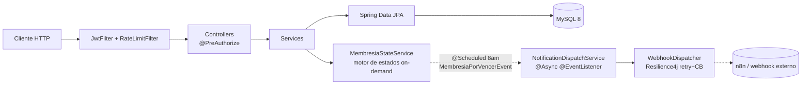

# ClubCore

> **API REST para la gestión integral de un instituto de salud / complejo deportivo**, construida
> alrededor de un problema difícil: **el estado de una membresía nunca puede ser una columna
> cacheada** — vencimiento, deuda, suspensión manual y cupo mensual de reservas cambian entre que
> alguien lo consulta y el momento en que hace check-in. Motor de estados on-demand, seguridad
> JWT+RBAC, y una garantía de concurrencia que se puede verificar con un test, no solo prometer.


 · 

Stack: **Java 21 · Spring Boot 3.5 · MySQL 8 · Resilience4j/Bucket4j · Docker**

### Estado: archivado

La demo pública y su deploy fueron dados de baja: el proyecto ya no está desplegado en ningún lado.
Se corre completo en local, con la base de datos y datos demo cargados, con un solo comando:

```bash
docker compose up --build
```

Después abrí http://localhost:8080/swagger-ui.html (ver [Cómo correr](#cómo-correr)).

---

## ¿Qué resuelve?

Cuando diez clientes intentan reservar el último cupo del mes al mismo tiempo, un sistema ingenuo
deja pasar a los diez. **ClubCore** sostiene la línea: el cupo se cierra con un lock por cliente
sostenido dentro de la misma transacción, así que entra exactamente uno y el resto recibe un
rechazo limpio, no una reserva fantasma.

**No es un CRUD con formularios.** El valor está en tres piezas de ingeniería real:

1. **Motor de estados verificable, no cacheado** — `MembresiaStateService` recalcula
   `ACTIVA`/`INACTIVA`/`DEUDA`/`SUSPENDIDA` on-demand en cada decisión crítica (reserva, check-in).
   Nunca lee un campo mutable guardado en la fila — el campo `estadoCacheado` es solo una copia
   derivada para listados, nunca la fuente de verdad.
2. **Concurrencia probada, no prometida** — el primer intento de cerrar el cupo mensual fue
   `@Transactional` + `SELECT ... FOR UPDATE`: bajo concurrencia real, 10 requests paralelas contra
   un plan con cupo=1 persistían las 10 igual (el commit de Spring ocurre después de que el método
   retorna, no antes). El fix real es un lock de JVM por cliente con `TransactionTemplate` en vez
   de la anotación — y queda como test de regresión, no como nota en un README.
3. **Resiliencia real en el webhook saliente** — retry con backoff exponencial + circuit breaker
   (Resilience4j) hacia n8n. El fallback vive en `@CircuitBreaker`, no en `@Retry` — al revés, el
   `@Retry` agota sus intentos y de todos modos propaga la excepción sin fallback, error detectado
   en verificación real contra el circuito abierto.

### Features

- **Motor de estados on-demand**, sin cache mutable — bloquea reservas y check-in automáticamente
  si la membresía no está `ACTIVA`.
- **Cupo mensual de reservas cerrado bajo concurrencia real** — lock por cliente + `TransactionTemplate`,
  verificado con 10 requests paralelas, cero reservas fantasma.
- **JWT + RBAC de punta a punta** — roles ADMIN/ENTRENADOR/CLIENTE vía `@PreAuthorize` por endpoint,
  contraseñas con BCrypt.
- **Webhooks resilientes** — retry + circuit breaker (Resilience4j) en el webhook saliente a n8n;
  webhook inbound de pagos simulando confirmación de gateway externo (firma HMAC sobre
  `timestamp.body`, ventana de 5 min contra replay, body acotado a 64 KB).
- **Rate limiting distribuible en el diseño** — Bucket4j en login (5/min) y webhooks (20/min) por IP.
- **Cache Caffeine** en el catálogo de planes (baja escritura, alta lectura), con métricas de
  hit/miss reales vía Actuator.
- **Observabilidad** — `/actuator/prometheus` y `/actuator/metrics` gateados a ADMIN, `/actuator/health`
  público, logging JSON estructurado en `prod`. En `prod` Swagger y `/actuator/info` quedan apagados.
- **CI** — GitHub Actions corre build + tests en cada push a `main`.

### En números

**53 tests** (unitarios + integración con Testcontainers contra MySQL 8.4 real) · test de
concurrencia real (10 requests paralelas contra cupo=1, 0 reservas de más) · CI propio en GitHub Actions (build + tests en cada push a `main`) · 9 controllers, 8
capas de servicio, arquitectura completa controller→service→repository.

---

## Arquitectura (resumen)

El detalle —motor de estados, por qué `TransactionTemplate` y no `@Transactional` en el lock de
reservas, por qué el fallback va en `@CircuitBreaker` y no en `@Retry`— está en
**[`ARCHITECTURE.md`](./ARCHITECTURE.md)**.



```
clubcore/
├── src/main/java/com/clubcore/api/
│   ├── controller/        9 controllers, @PreAuthorize por endpoint
│   ├── service/           lógica de dominio + MembresiaStateService (motor de estados)
│   │   └── impl/
│   ├── security/          JwtFilter, JwtService, RateLimitFilter (Bucket4j)
│   ├── config/            SecurityConfig, CacheConfig, AsyncConfig, DeployInfoContributor
│   ├── entity/            JPA — Cliente, Membresia, Plan, Pago, Reserva, Acceso, Rutina
│   ├── dto/                request/ + response/
│   ├── mapper/             MapStruct Entity ↔ DTO
│   ├── event/              MembresiaPorVencerEvent (job @Scheduled diario)
│   └── exception/          GlobalExceptionHandler, sin stack traces al cliente
├── src/main/resources/
│   ├── db/migration/       Flyway V1 (schema) — corre en todos los perfiles
│   └── db/seed/            V2 datos demo (usuarios con contraseña pública) — SOLO perfil dev
├── docker-compose.yml
├── Dockerfile
└── ARCHITECTURE.md
```

---

## Cómo correr

```bash
git clone https://github.com/mateopavoni/clubcore.git && cd clubcore
docker compose up --build     # MySQL 8.4 + la API; no hace falta crear un .env
```

- API: http://localhost:8080 — Swagger UI: http://localhost:8080/swagger-ui.html
- Es el perfil `dev`: Flyway carga también los datos demo de `db/seed`. Los secretos del compose son
  de uso local; la base no publica puertos y la API solo escucha en `127.0.0.1`.

```bash
curl -X POST http://localhost:8080/api/v1/auth/login \
  -H "Content-Type: application/json" \
  -d '{"email":"admin@clubcore.com","password":"Admin1234!"}'
```

Usuarios demo (`Admin1234!` para los tres, **solo en dev**): `admin@clubcore.com` (ADMIN),
`entrenador@clubcore.com` (ENTRENADOR), `cliente1@clubcore.com` (CLIENTE). El perfil `prod` no crea
ningún usuario. Más detalle en [RUN.md](RUN.md).

---

## La demo de concurrencia

```bash
./gradlew test --tests '*ReservaConcurrencyTest*'
```

Dispara 10 requests paralelas contra un cliente con un plan de cupo=1. Sin el lock, las 10 se
persistirían igual (verificado así con el fix anterior). Salida real de la corrida:

```
Plan con cupo mensual: 1 reserva
Disparando 10 requests concurrentes contra el mismo cliente...

Resultado
---------
  reservas confirmadas : 1
  rechazadas (cupo)    : 9
  filas en la tabla    : 1
```

---

## Tests

```bash
./gradlew test     # necesita Docker: el test de integración levanta MySQL con Testcontainers
```

La suite cubre el motor de estados (10 casos), RBAC por endpoint, el circuit breaker del webhook
(Resilience4j), la migración Flyway + motor de estados contra MySQL real (Testcontainers), y el
fix de concurrencia de reservas de arriba.

---

## Limitaciones conocidas

Ninguna de estas es un descuido — son simplificaciones deliberadas con un techo conocido:

- **Bucket4j y el lock de reservas son en memoria** — válidos para una sola instancia. Escalar a
  réplicas necesita un rate limiter distribuido (Redis) y mover el chequeo de cupo a un `UPDATE`
  atómico condicionado en SQL.
- **El pago es simulado** — el webhook inbound confirma pagos como lo haría un gateway real, pero
  no hay integración con Mercado Pago/Stripe (documentado a propósito, es un proyecto de portfolio).
- **El webhook saliente es best-effort** — retry + circuit breaker, pero sin dead-letter queue. Si
  n8n está caído más allá de la ventana de retry, esa notificación puntual se pierde.
- **El rate limit mira la IP de la conexión**, no `X-Forwarded-For` (se puede falsificar). Detrás de un
  reverse proxy hay que arrancar con `FORWARD_HEADERS_STRATEGY=native`; si no, todos los clientes
  comparten el límite del proxy.
- **Una sola instancia de MySQL**, sin réplicas ni failover — coherente con el resto de las
  limitaciones de infra de arriba.

---

## Licencia

© 2026 Mateo Pavoni. Todos los derechos reservados. Software propietario, publicado solo con fines
de evaluación/portfolio. Prohibida su copia, redistribución o reuso sin autorización escrita. Ver
[LICENSE](./LICENSE).
